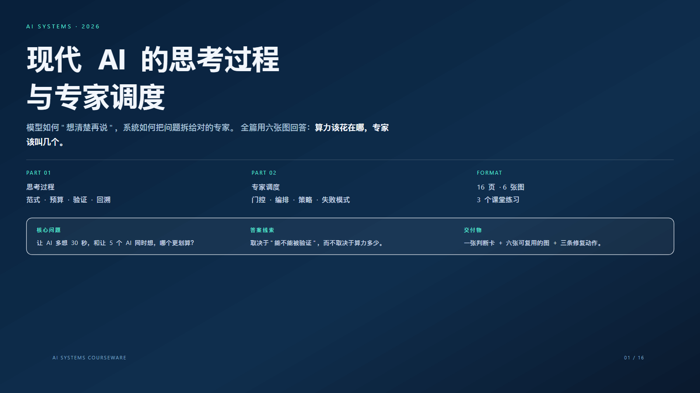
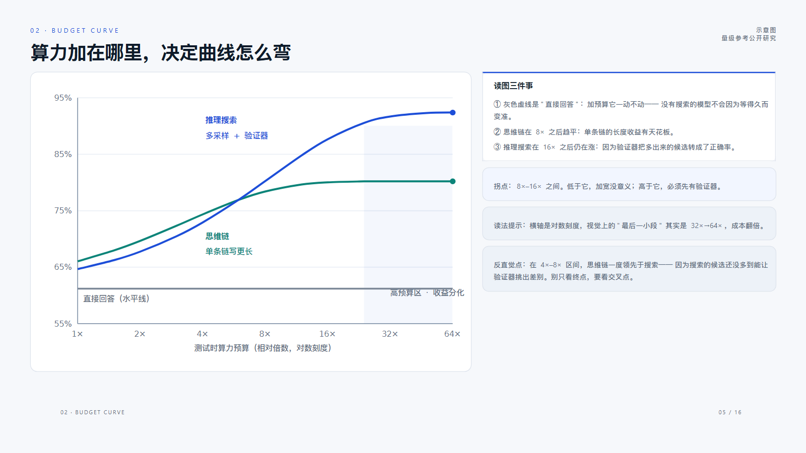
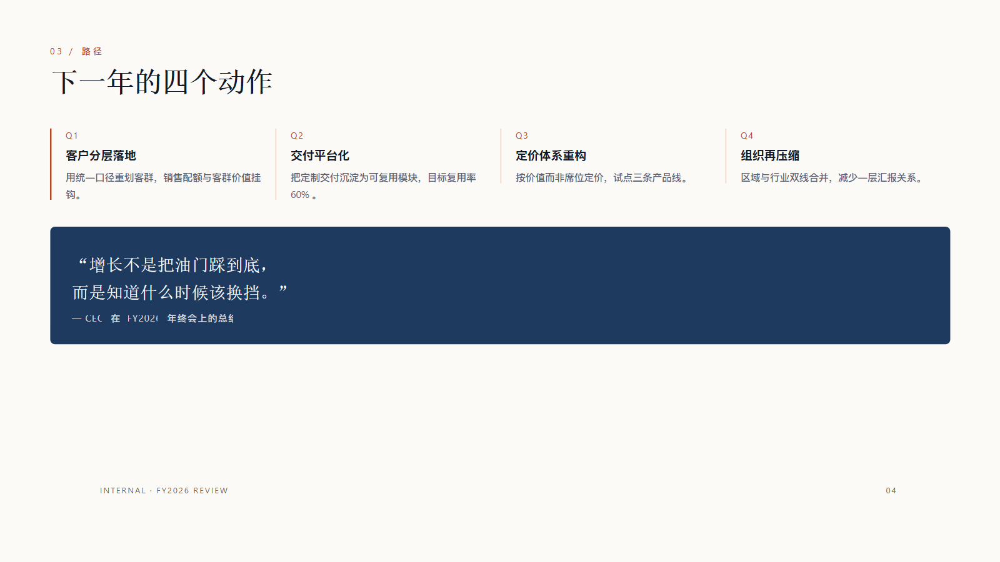
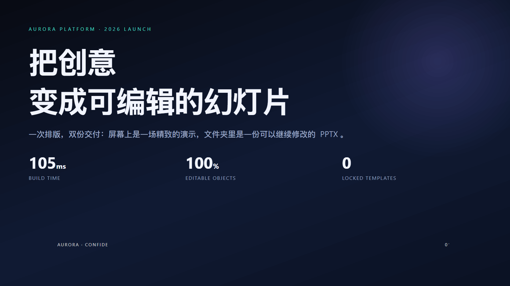

# PPT Press

[](LICENSE)
[](pyproject.toml)
[](tools/github-actions-ci.yml)

**Author decks in HTML/CSS, deliver natively editable PowerPoint.**

A pure-Python layout compiler writes DrawingML objects directly: no browser, no
screenshots, no locked master. The style comes from a stylesheet you write, the
content from your copy — a 16-page deck builds in about half a second.

```bash
python -m pptpress build examples/ai-thinking-orchestration.html -o deck.pptx
```

```
PPT Press build -> deck.pptx
  slides : 16
  objects: 812
  time   : 680 ms parse=5ms css=4ms layout=120ms pptx=520ms
```



---

## What it is

A **layout compiler**: HTML + CSS in, `.pptx` out.

| Input | Handling | Output |
|---|---|---|
| `<section class="slide">` | one section = one slide | Slide |
| `h1` / `p` / `li` | real font metrics drive the line breaks | paragraphs + runs |
| `div` + `background` + `border` | box model → rect / rounded rect | autoshape + native fill |
| `display:grid` / `flex` | track and flex resolution | exact coordinates |
| `<table>` | cells and merges | native table |
| inline `<svg>` | primitives → custom geometry | vector shapes (recolourable) |
| `<aside class="notes">` | narration | speaker notes |

**The defining property**: the output contains no full-page bitmap. Open it in
PowerPoint and every word can be retyped, every block recoloured, every table
cell filled in, every icon ungrouped.

---

## Why not "screenshot to PPT"

| Common approach | Deliverable | Cost |
|---|---|---|
| Paste page screenshots | a stack of images | one word change reshoots a page |
| Fill a fixed master | a layout straitjacket | content outgrows the slots |
| Lay out by hand | a time sink | a whole day for 20 pages |
| Headless-browser rendering | seconds per build + bitmaps | fonts drift, nothing is editable |

PPT Press takes the opposite path: **compute the layout itself**. Because the
geometry is already a set of numbers (points) before any file is written, no
browser is needed to "see" the page — and therefore nothing must be photographed.

The trade-off is a deliberately bounded CSS surface; see [Support](#support).

---

## Install

```bash
python -m pip install -r requirements.txt
# or install as a package
python -m pip install -e .
```

| Dependency | Purpose |
|---|---|
| `python-pptx` | writes the PPTX |
| `lxml` | parses HTML and SVG |
| `tinycss2` | parses CSS |
| `Pillow` | reads real font metrics (line-break accuracy) |

Fully offline: no Chromium, no Office, no network, no API keys.
LibreOffice is used **only** by the optional per-page PNG preview.

Requires Python ≥ 3.9. Verified on Windows 11 + Python 3.12; there is no
platform-specific code, so Linux and macOS behave the same.

### As a skill

`SKILL.md` lives at the repository root, so the whole directory is a
self-contained skill:

```
<skills-dir>/
└─ pptpress/
   ├─ SKILL.md          ← the executor reads this for the full procedure
   ├─ pptpress/         ← the Python package
   ├─ tools/ docs/ examples/ tests/
   └─ requirements.txt
```

---

## Four commands

```bash
python -m pptpress build   deck.html -o deck.pptx   # build
python -m pptpress preview deck.html -o preview/    # per-page SVG preview
python -m pptpress check   deck.html                # validate, write nothing
python -m pptpress themes                           # list built-in themes
```

`build --json` emits a machine-readable report (slides, objects, timings,
overflow list) that is easy to wire into CI.

---

## Python API

```python
from pptpress import build_file, preview_file

result = build_file("deck.html", "deck.pptx")
print(result.ok, len(result.slides), result.objects)
for issue in result.issues:      # e.g. "slide 7: content overflow (3pt) in <div …>"
    print(issue)

preview_file("deck.html", "preview/")   # one SVG per slide
```

The lower-level entry point is `pptpress.pipeline`: `layout_document()` lays out
without writing a file, which is how the tests assert geometry.

---

## How it works

```
  deck.html
     │  dom.py            lxml → node tree (class sets, whitespace-aware text)
     ▼
  Node tree
     │  css.py            cascade, specificity, custom properties, inline styles
     │  values.py         lengths / colours / gradients / grid tracks → points
     ▼
  Computed style
     │  metrics.py        real PIL/FreeType advance widths; CJK measured per glyph
     │  layout.py         block flow / flex / grid / absolute / table / inline
     ▼
  Box tree (every box has point coordinates and measured lines)
     │  writer.py         python-pptx + raw XML
     │  xmlutil.py        fills, outlines, shadows, gradients, fonts
     │  svgshape.py       inline SVG → custom geometry + native text boxes
     ▼
  deck.pptx
```

**Three decisions that define the output**

1. **Layout uses real font metrics.** The first *installed* family in the stack is
   the one written into the PPTX, so the measuring font and the file's font are
   always the same — a font substitution cannot overflow a slide.
2. **Each laid-out line becomes one paragraph, with `word_wrap = False`.**
   PowerPoint never re-wraps, so the breaks you see in the HTML are the breaks
   that ship.
3. **All geometry is in points.** A 1280×720 px canvas is 960×540 pt (1px =
   0.75pt); a deck converts units exactly once, at parse time.

---

## What HTML becomes

| HTML / CSS | PowerPoint object | Editable |
|---|---|---|
| `div` / `section` with a background | autoshape (rect / rounded) | colour, corner, border |
| `h1`…`h6` / `p` / `li` | text box, **one paragraph per line** | text, font, size, colour |
| `<b> <i> <u> <s> <span style>` | runs inside the paragraph | each run independently |
| `ul` / `ol` | native bullets (`buChar`) / native numbering (`buAutoNum`) | bullet and scheme |
| `` | picture with `object-fit` crop | replace, crop, recolour |
| inline `<svg>` | **native custom geometry** | select, recolour, scale |
| `<table>` | native table (merged cells included) | type directly into cells |
| `box-shadow` | native outer shadow | blur / offset / colour |
| `linear-gradient` | native gradient fill | colour stops |
| `transform: rotate()` / `translate()` | rotation / offset | angle, position |
| `<aside class="notes">` | speaker notes | edit the notes |

---

## Examples

Each example ships with its built `.pptx`, so you can open it and verify the
editability claims yourself.

| Example | Mood | Pages | Objects | Build |
|---|---|---|---|---|
| [`ai-thinking-orchestration`](examples/ai-thinking-orchestration.html) | light courseware + 6 inline-SVG charts | 16 | 812 | ~680 ms |
| [`aurora-launch`](examples/aurora-launch.html) | dark product launch | 6 | 195 | ~120 ms |
| [`annual-review`](examples/annual-review.html) | paper-toned business review (native tables) | 4 | 119 | ~96 ms |
| [`editorial-keynote`](examples/editorial-keynote.html) | editorial serif keynote | 4 | 86 | ~66 ms |







The charts in the courseware are not images: the curves are SVG `<path>` data
turned into custom geometry, and the axis labels are **native text boxes**
(`examples/charts/build_charts.py` generates real coordinates).

---

## Validation

```bash
python tools/check_deck.py deck.pptx           # contrast / bleed / full-page raster / editability
python tools/check_deck.py deck.pptx --strict  # include advisory warnings
python tools/render_pptx.py deck.pptx shots    # per-page PNG (needs LibreOffice)
python tools/verify_editability.py deck.pptx --source deck.html
python tools/bench.py                          # build every example and time it
```

`check_deck.py` looks at four things, and each one is a delivery red line:

| Check | Criterion | Result |
|---|---|---|
| Full-page bitmap | one picture covering ≥ 50% of the slide | `!` error |
| Editable text | at least one non-empty text frame per slide | `!` error |
| Text contrast | body ≥ 4.5:1, headings ≥ 3:1 (translucent layers composited) | `~` advisory |
| Bleed | a shape crossing the slide edge | `~` advisory (often intentional) |

---

## Documentation

| Document | Contents |
|---|---|
| [`SKILL.md`](SKILL.md) | workflow, three gates, quality checklist, failure-repair table |
| [`docs/authoring-guide.md`](docs/authoring-guide.md) | HTML/CSS rules, element mapping, recipes |
| [`docs/pattern-library.md`](docs/pattern-library.md) | 5 mood presets × 12 page skeletons |
| [`docs/architecture.md`](docs/architecture.md) | engine layers, data structures, coordinate system, extension points |
| [`docs/roadmap.md`](docs/roadmap.md) | technical roadmap and priorities |
| [`docs/benchmarks.md`](docs/benchmarks.md) | size, timing, output composition, reproduction commands |
| [`docs/known-gaps.md`](docs/known-gaps.md) | measured limitations: symptom, root cause, code location, fix order |
| [`CONTRIBUTING.md`](CONTRIBUTING.md) | dev setup, layer responsibilities, three non-negotiable constraints |
| [`CHANGELOG.md`](CHANGELOG.md) | release history |

---

## Support

**Layout**: block flow, Flexbox (direction / wrap / gap / grow / align), CSS Grid
(`repeat()`, `fr`, `auto`, `minmax()`, `auto-fit`, mixed tracks, `grid-column: span N`,
explicit placement, `align-content`), absolute positioning and bleed, inline line
wrapping, native tables (merged cells, per-cell borders).

**Paint**: solid / gradient / image backgrounds, rounded corners (per-corner and
elliptical), per-side borders with `dashed` / `dotted`, outer shadows,
translucency, rotation and translation, `object-fit`, letter-spacing /
line-height / uppercase / underline / strike-through, `sub` / `sup`, text shadows.

**Canvas**: `data-size` accepts `16:9`, `4:3`, `1:1`, `9:16`, `3:2`, `16:10`,
`A4`, or any `WxH`.

**Built-in themes** (optional presets, not masters):

| Theme | Mood |
|---|---|
| `paper` | warm light, business reviews |
| `noir` | dark launch keynotes |
| `swiss` | Swiss minimal, black / white / red |
| `ocean` | cool blue, product and engineering |
| `ember` | warm dark, narrative |
| `mint` | light green, training |
| `blueprint` | engineering blueprint |
| `risograph` | high-saturation print |

**Not supported (by design)**: `float`, `columns`, `filter`, `clip-path`,
`@keyframes`, `transform` on text runs, media queries, `writing-mode`,
`::before` / `::after` content. They cannot map onto an editable PowerPoint
object, and faking them would only produce a picture — the exact outcome this
project exists to avoid. See [`docs/known-gaps.md`](docs/known-gaps.md) for the
current list with code locations.

---

## Measured

All numbers below are reproducible on one machine (Windows 11 / Python 3.12);
commands are in [`docs/benchmarks.md`](docs/benchmarks.md).

**Size**

| Metric | Value |
|---|---|
| Source files | 51 |
| Source size | 0.52 MB |
| Engine modules | 19 / 8,181 lines |
| All Python | 27 files / 9,492 lines |
| Bundled third-party assets | 0 |

**Build time**

| Example | Pages | Objects | Time | Output |
|---|---|---|---|---|
| 16-page chart courseware | 16 | 812 | **680 ms** | 119 KB |
| 6-page dark launch | 6 | 195 | **120 ms** | 44 KB |
| 4-page paper review | 4 | 119 | **96 ms** | 37 KB |
| 4-page editorial keynote | 4 | 86 | **66 ms** | 34 KB |

**Output composition** (16-page deck)

| Object | Count | Editable |
|---|---|---|
| Text boxes | 404 | double-click to retype |
| Autoshapes (cards, blocks, axes) | 203 | recolour, scale |
| Freeform shapes (chart curves) | 35 | recolour, adjust points |
| Native tables | 4 | type into cells |
| Pictures | **0** | — |
| Editable characters | 6,069 | all of it |

**Validation**

```bash
python -m pytest tests -q                            # 94 passed
python tools/check_deck.py examples/*.pptx --strict  # 4 examples, 0 errors 0 warnings
```

---

## Repository layout

```
pptpress/
├─ pptpress/            engine (19 modules, 7.4k lines)
│  ├─ dom.py            HTML → DOM
│  ├─ css.py            cascade and computed style (incl. the UA stylesheet)
│  ├─ values.py         lengths / colours / gradients / grid tracks
│  ├─ metrics.py        real font metrics
│  ├─ layout.py         flex / grid / flow layout
│  ├─ writer.py         native DrawingML writer
│  ├─ xmlutil.py        fills, outlines, shadows, fonts
│  ├─ svgshape.py       inline SVG → native shapes and text
│  ├─ svgicon.py        icon rasterisation fallback
│  ├─ themes.py         themes (CSS variables + PPTX theme colours)
│  ├─ preview*.py       SVG / HTML preview
│  └─ pipeline.py  cli.py  slides.py  util.py  env.py
├─ tools/               delivery checks and benchmarks
├─ tests/               94 engine, gap and motion tests
├─ examples/            4 examples + built decks + chart generator + screenshots
└─ docs/                authoring guide, pattern library, architecture, roadmap,
                        benchmarks, known gaps
```

---

## Roadmap

Full version in [`docs/roadmap.md`](docs/roadmap.md). Near-term priorities:

| Priority | Item |
|---|---|
| P0 | Native chart objects (`c:chart`): bar / line / pie keep editable data |
| P0 | Remaining CSS: `writing-mode`, `::before`/`::after`, `calc()` / `clamp()` |
| P1 | Parallel page layout and XML-direct writing (large decks) |
| P1 | One-source, two-theme builds (light and dark from the same HTML) |
| P2 | Native approximations for SVG filters and masks (fewer PNG fallbacks) |
| P2 | PPTX → HTML import, for modernising existing templates |

---

## Contributing

See [`CONTRIBUTING.md`](CONTRIBUTING.md). Three non-negotiable constraints:

1. no full-page bitmaps;
2. no browser / headless rendering;
3. no hard-coded templates.

Self-check: `python -m pytest tests -q`

Security reports: see [`SECURITY.md`](SECURITY.md).

---

## License

[MIT](LICENSE).
