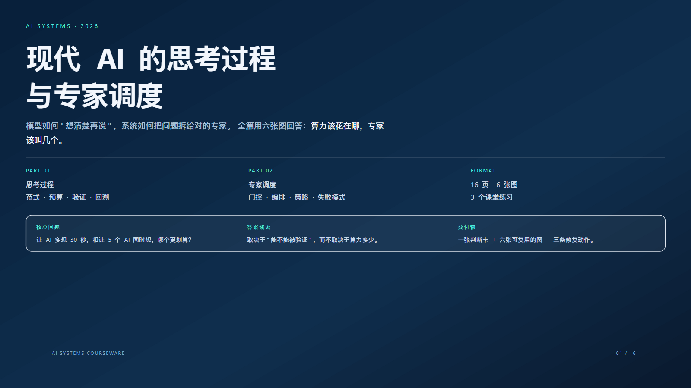
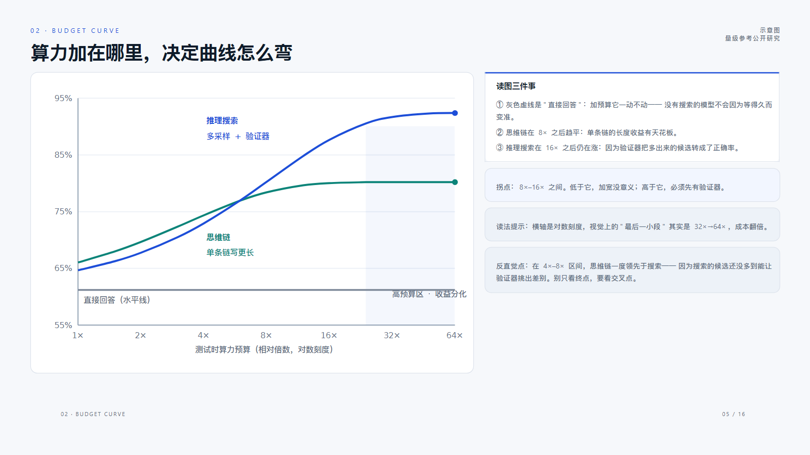
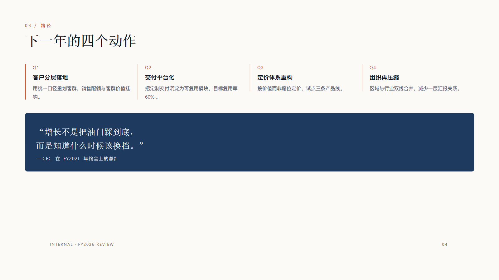
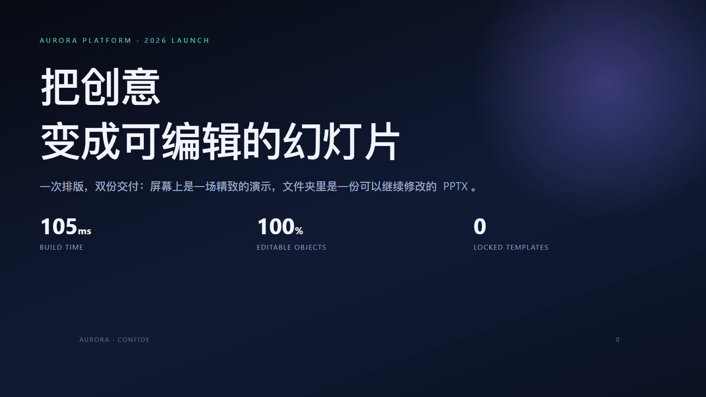

# PPT Press

**用 HTML/CSS 写版面，交付原生可编辑的 PowerPoint。**

纯 Python 计算排版，直接写出 DrawingML 对象：没有浏览器、没有截图、没有写死的母版。
风格来自你写的一份 CSS，内容来自你的文案——构建一份 16 页课件约 0.6 秒。

```bash
python -m pptpress build examples/ai-thinking-orchestration.html -o deck.pptx
```

```
PPT Press build -> deck.pptx
  slides : 16
  objects: 812
  time   : 545 ms parse=4ms css=3ms layout=114ms pptx=424ms
```



---

## 目录

- [它是什么](#它是什么)
- [为什么不是"截图转 PPT"](#为什么不是截图转-ppt)
- [安装](#安装)
- [三个命令](#三个命令)
- [Python API](#python-api)
- [它怎么工作](#它怎么工作)
- [HTML 会变成什么](#html-会变成什么)
- [示例](#示例)
- [交付校验](#交付校验)
- [文档](#文档)
- [支持范围](#支持范围)
- [实测数据](#实测数据)
- [目录结构](#目录结构)
- [路线图](#路线图)
- [参与贡献](#参与贡献)
- [许可证](#许可证)

---

## 它是什么

一个**排版编译器**：输入是 HTML + CSS，输出是 `.pptx`。

| 输入 | 处理 | 输出 |
|---|---|---|
| `<section class="slide">` | 每节 = 一页幻灯片 | Slide |
| `h1` / `p` / `li` | 用真实字体度量断行 | 段落 + 文本运行 |
| `div` + `background` + `border` | 盒模型 → 矩形/圆角矩形 | 自选形状 + 原生填充 |
| `display:grid` / `flex` | 轨道与伸缩计算 | 精确坐标 |
| `<table>` | 单元格与合并 | 原生表格 |
| 内联 `<svg>` | 图元 → 自定义几何 | 矢量形状（可改色） |
| `<aside class="notes">` | 备注 | 演讲者备注 |

**关键性质**：构建产物里没有一个整页位图。打开 PowerPoint 后，任意文字都能双击改，
任意色块都能改色，表格能直接填数，图标能拆开重排。

---

## 为什么不是"截图转 PPT"

| 常见做法 | 交付物 | 后果 |
|---|---|---|
| 整页截图塞进 PPT | 一堆图片 | 改一个字要重做整页 |
| 填充固定母版 | 排版牢笼 | 内容一变就撑破槽位 |
| 手工排版 | 时间黑洞 | 20 页耗掉一整天 |
| 无头浏览器渲染 | 秒级构建 + 位图 | 字体不可控、产物不可编辑 |

PPT Press 走第四条路的反面：**自己算排版**。因为版面几何在 PDF/PPTX 之前就已经
是确定的数字（点），所以不需要浏览器来"看图"，也就不需要把结果拍成图片。

代价是 CSS 支持范围必须收窄——见[支持范围](#支持范围)。

---

## 安装

```bash
python -m pip install -r requirements.txt
# 或作为包安装
python -m pip install -e .
```

| 依赖 | 用途 |
|---|---|
| `python-pptx` | 写出 PPTX |
| `lxml` | 解析 HTML / SVG |
| `tinycss2` | 解析 CSS |
| `Pillow` | 读取真实字体度量（断行精度） |

纯离线：不需要 Chromium、不需要 Office、不需要网络与密钥。
LibreOffice **只**在可选的逐页 PNG 预览时用到。

要求 Python ≥ 3.9。已在 Windows 11 + Python 3.12 上验证，Linux/macOS 无平台相关代码。

### 作为技能安装

`SKILL.md` 在仓库根目录，整个目录即一个自包含技能：

```
<skills-dir>/
└─ pptpress/
   ├─ SKILL.md          ← 执行者读这个即获得完整规程
   ├─ pptpress/        ← Python 包
   ├─ tools/ docs/ examples/ tests/
   └─ requirements.txt
```

---

## 三个命令

```bash
python -m pptpress build   deck.html -o deck.pptx       # 构建
python -m pptpress preview deck.html -o preview/        # 逐页 SVG 预览
python -m pptpress check   deck.html                    # 只校验，不落盘
python -m pptpress themes                               # 列出内置主题
```

`build --json` 输出机器可读报告（页数、对象数、耗时、溢出清单），适合接 CI。

---

## Python API

```python
from pptpress import build_file, preview_file

result = build_file("deck.html", "deck.pptx")
print(result.ok, len(result.slides), result.objects)
for issue in result.issues:      # 例如 "slide 7: content overflow (3pt) in <div …>"
    print(issue)

preview_file("deck.html", "preview/")   # 每页一个 SVG
```

底层入口在 `pptpress.pipeline`：`layout_document()` 只排版不写文件，
便于拿几何做自动化断言（测试就是这么写的）。

---

## 它怎么工作

```
  deck.html
     │  dom.py            lxml → 节点树（class 集合、空白文本）
     ▼
  Node tree
     │  css.py            样式表级联、特异性、自定义属性、inline style
     │  values.py         长度/颜色/渐变/网格轨道 → 点
     ▼
  Computed style
     │  metrics.py        PIL/FreeType 真实字宽；CJK 按全角度量
     │  layout.py         块流 / flex / grid / absolute / table / inline
     ▼
  Box tree（每个盒子都有 pt 坐标与测量好的行）
     │  writer.py         python-pptx + 原始 XML
     │  xmlutil.py        填充、描边、阴影、渐变、字体
     │  svgshape.py       内联 SVG → 自定义几何 + 原生文本框
     ▼
  deck.pptx
```

**三个决定性的设计选择**

1. **排版只用真实字体度量。** 字体栈中第一个*已安装*的字体被写进 PPTX，
   所以"测量用的字体"和"文件里的字体"永远是同一个，不会因为替换字体而overflow。
2. **每一行排版结果 = 一个段落，`word_wrap = False`。** PowerPoint 不会再折行，
   你在 HTML 里看到的断点就是交付的断点。
3. **所有几何单位是点（pt）。** 1280×720 px 画布 = 960×540 pt（1px = 0.75pt），
   一篇 deck 从解析到写盘只做一次单位归一。

---

## HTML 会变成什么

| HTML / CSS | PowerPoint 对象 | 可编辑 |
|---|---|---|
| `div` / `section` 画了背景 | 自选形状（矩形/圆角） | 改色、改圆角、改边框 |
| `h1`…`h6` / `p` / `li` | 文本框，**一行一段落** | 改文字、字体、字号、颜色 |
| `<b> <i> <span style>` | 段落内的运行 | 独立改字 |
| `ul` / `ol` | 原生项目符号（`buChar`） | 改符号样式 |
| `` | 图片 + `object-fit` 裁切 | 替换、裁切、改色 |
| 内联 `<svg>` | **原生自定义几何形状** | 选中、改色、缩放不糊 |
| `<table>` | 原生表格（含合并单元格） | 直接在单元格里输入 |
| `box-shadow` | 原生外阴影 | 改模糊/偏移/颜色 |
| `linear-gradient` | 原生渐变填充 | 改色标 |
| `transform: rotate()` | 形状旋转 | 改角度 |
| `<aside class="notes">` | 演讲者备注 | 编辑备注 |

---

## 示例

四份示例都附带已构建的 `.pptx`，可直接打开核对可编辑性。

| 示例 | 气质 | 页数 | 对象数 | 构建耗时 |
|---|---|---|---|---|
| [`ai-thinking-orchestration`](examples/ai-thinking-orchestration.html) | 浅色课件 + 6 张内联 SVG 图表 | 16 | 812 | ~545 ms |
| [`aurora-launch`](examples/aurora-launch.html) | 深色发布会 | 6 | 195 | ~100 ms |
| [`annual-review`](examples/annual-review.html) | 纸感经营复盘（原生表格） | 4 | 119 | ~85 ms |
| [`editorial-keynote`](examples/editorial-keynote.html) | 出版感主题演讲 | 4 | 86 | ~70 ms |







示例里的图表不是贴图：曲线是 SVG `<path>` 转成的自定义几何，坐标轴标签是
**原生文本框**（`examples/charts/build_charts.py` 生成真实坐标）。

---

## 交付校验

```bash
python tools/check_deck.py deck.pptx           # 对比度 / 出血 / 整页位图 / 可编辑性
python tools/check_deck.py deck.pptx --strict  # 把提示也列出来
python tools/render_pptx.py deck.pptx shots    # 逐页 PNG（需 LibreOffice）
python tools/verify_editability.py deck.pptx --source deck.html
python tools/bench.py                          # 批量构建 + 计时
```

`check_deck.py` 只看四件事，但每一条都是"交付级"红线：

| 检查 | 判据 | 结果 |
|---|---|---|
| 整页位图 | 单张图片面积 ≥ 页面 50% | `!` 错误 |
| 可编辑文本 | 每页至少有一个非空文本框 | `!` 错误 |
| 文字对比度 | 正文 ≥ 4.5:1，标题 ≥ 3:1 | `~` 提示 |
| 出血 | 形状越过页面边界 | `~` 提示（有意设计） |

---

## 文档

| 文档 | 内容 |
|---|---|
| [`SKILL.md`](SKILL.md) | 工作流、三道闸门、质量清单、失败修复表（给执行者看的规程） |
| [`docs/authoring-guide.md`](docs/authoring-guide.md) | HTML/CSS 写法、元素映射表、配方片段 |
| [`docs/pattern-library.md`](docs/pattern-library.md) | 5 套气质配方 × 12 种页面骨架 |
| [`docs/architecture.md`](docs/architecture.md) | 引擎分层、数据结构、坐标系统、扩展点 |
| [`docs/roadmap.md`](docs/roadmap.md) | 技术路线图与优先级 |
| [`docs/benchmarks.md`](docs/benchmarks.md) | 体积、耗时、产物尺寸与校验结果的复现命令 |
| [`CONTRIBUTING.md`](CONTRIBUTING.md) | 开发环境、分层责任、不可回退的三条约束 |
| [`CHANGELOG.md`](CHANGELOG.md) | 版本记录 |

---

## 支持范围

**排版**：块级流、Flexbox（方向/换行/间隙/伸缩/对齐）、CSS Grid
（`repeat()`、`fr`、`auto`、混合轨道）、绝对定位与出血、内联行换行、
原生表格（合并单元格、逐格边框）。

**视觉**：纯色/渐变/图片背景、圆角、分边边框、外阴影、透明度、旋转、
`object-fit`、字距/行高/大写/下划线。

**画布**：`data-size` 支持 `16:9`、`4:3`、`1:1`、`9:16`、`3:2`、`16:10`、`A4`、
以及任意 `WxH`。

**内置主题**（可选预设，不是母版）：

| 主题 | 气质 |
|---|---|
| `paper` | 纸感浅色，适合经营复盘 |
| `noir` | 深色发布会 |
| `swiss` | 瑞士极简，黑白红 |
| `ocean` | 冷蓝，适合产品与技术 |
| `ember` | 暖橙深色，适合叙事 |
| `mint` | 轻松绿色，适合培训 |
| `blueprint` | 工程蓝图 |
| `risograph` | 高饱和印刷感 |

**不支持（有意为之）**：`float`、`columns`、`filter`、`clip-path`、`@keyframes`、
文本级 `transform`、媒体查询。它们无法映射到可编辑的 PowerPoint 对象，
硬做只能退化成图片——那正是本项目要避免的结果。

---

## 实测数据

全部为本项目自身的可复现测量（Windows 11 / Python 3.12 / 单机），
复现命令见 [`docs/benchmarks.md`](docs/benchmarks.md)。

**体积**

| 指标 | 数值 |
|---|---|
| 源码文件 | 43 |
| 源码体积 | 0.45 MB |
| 引擎模块 | 19 个 / 7,415 行 |
| 全部 Python 代码 | 26 个文件 / 8,443 行 |
| 随包第三方素材 | 0 |

**构建耗时**

| 示例 | 页数 | 对象数 | 耗时 | 产物 |
|---|---|---|---|---|
| 16 页图表课件 | 16 | 812 | **541 ms** | 103 KB |
| 6 页深色演示 | 6 | 195 | **105 ms** | 40 KB |
| 4 页纸感复盘 | 4 | 119 | **91 ms** | 36 KB |
| 4 页出版感演讲 | 4 | 86 | **59 ms** | 34 KB |

**产物构成**（16 页课件）

| 对象 | 数量 | 可编辑 |
|---|---|---|
| 文本框 | 404 | 双击即可改字 |
| 形状（含图表路径、卡片、色块） | 242 | 可改色、可缩放 |
| 图片 | **0** | —— |
| 可编辑字符 | 6,069 | 全部 |

**校验**

```bash
python -m pytest tests -q                       # 10 passed
python tools/check_deck.py examples/*.pptx --strict   # 4 份示例 0 错误 0 警告
```

细项与口径见 [`docs/benchmarks.md`](docs/benchmarks.md)。

---

## 目录结构

```
pptpress/
├─ pptpress/            引擎（19 个模块，7.4k 行）
│  ├─ dom.py             HTML → DOM
│  ├─ css.py              CSS 级联与计算样式
│  ├─ values.py           长度/颜色/渐变/网格轨道解析
│  ├─ metrics.py          真实字体度量
│  ├─ layout.py           Flex / Grid / 流式排版
│  ├─ writer.py           原生 DrawingML 写出
│  ├─ xmlutil.py          填充/描边/阴影/字体底层 XML
│  ├─ svgshape.py         内联 SVG → 原生形状与文本框
│  ├─ svgicon.py          图标回退渲染
│  ├─ themes.py           主题（CSS 变量 + PPTX 主题色）
│  ├─ preview*.py         SVG / HTML 预览
│  └─ pipeline.py  cli.py  slides.py  util.py  env.py
├─ tools/                 交付校验与基准
├─ tests/                 引擎自测（10 项）
├─ examples/              4 份示例 + 构建产物 + 图表生成脚本 + 截图
└─ docs/                  写作指南、配方库、架构、路线图、实测数据
```

---

## 路线图

完整版见 [`docs/roadmap.md`](docs/roadmap.md)。近期优先级：

| 优先级 | 事项 |
|---|---|
| P0 | 原生图表对象（`c:chart`）：柱/线/饼保留数据可编辑 |
| P0 | 更多 CSS：`gap` 的 `row-gap`/`column-gap` 分离、`aspect-ratio` |
| P1 | 增量构建与并行排版（大 deck 多页并行） |
| P1 | 深浅色主题一键重排（同一内容两套变量） |
| P2 | SVG 滤镜/遮罩的原生近似（避免图标回退为 PNG） |
| P2 | PPTX → HTML 反向导入（用于改造既有模板） |

---

## 参与贡献

见 [`CONTRIBUTING.md`](CONTRIBUTING.md)。三条不可回退的约束：

1. 不允许整页位图；
2. 不允许引入浏览器/无头渲染；
3. 不允许写死模板。

自测：`python -m pytest tests -q`

---

## 许可证

[MIT](LICENSE)。
